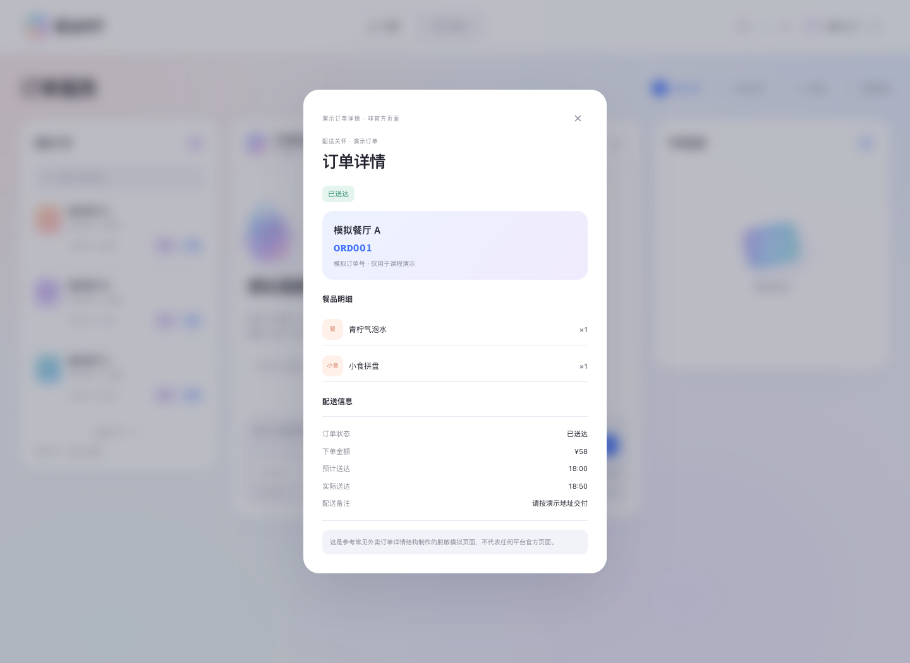
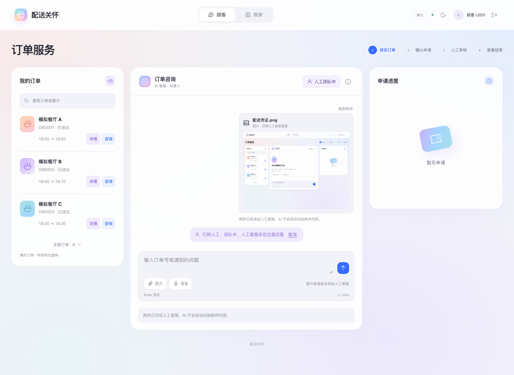
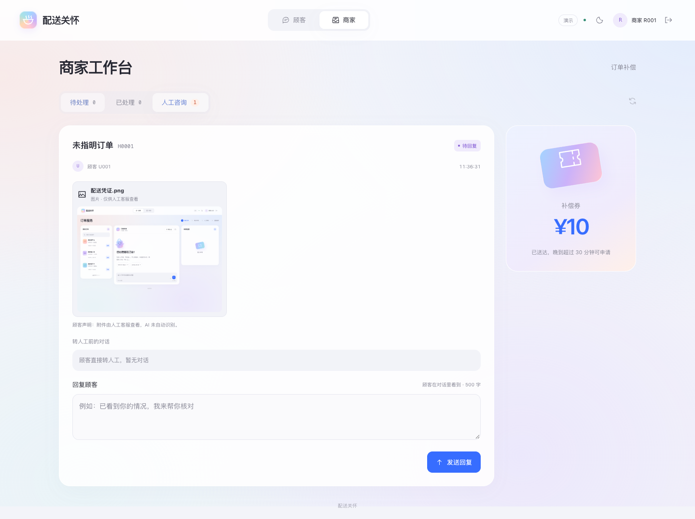
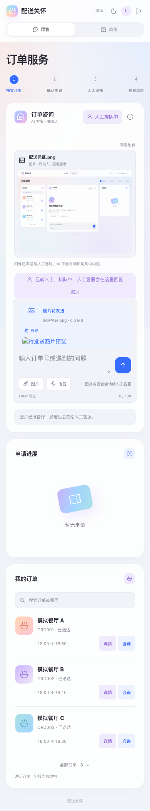

# ORD001 参考原型

这个原型给 IS5542 Group 24 提供一份可重跑的流程。团队首版采用 LangChain／LangGraph，补偿政策待确认。示例中的规则仅用于对照验收。已送达且超过 30 分钟时，程序拟 ¥10 券，交人工审批。

项目当前安排和团队交件见 [当前方案与进度](../../notes/current-plan.md)。

## 本机网页：顾客端与审批端

网页和 Studio 使用独立的端口。网页默认使用模拟模型，不需要模型密钥。订单为 [demo-data.json](demo-data.json)，补偿参数为 [demo-policy.json](demo-policy.json) 的 demo-v1：已送达、晚到严格超过 30 分钟，建议 ¥10 模拟券，顾客确认后进入人工审批。

新版页面、交互与截图见 [界面升级说明](../../notes/team/ord001-ui-upgrade-2026-11-10.md)，完整浏览器复跑见 [UI 检查说明](ui-check/README.md)。在 GitHub 查看负责人、分支和待复核状态，见 [GitHub 组内协作方式](../../notes/team/github-collaboration.md)。

### 2026-11-13 媒体交付与界面证据

本轮网页已经补上顾客端的模拟订单详情、图片上传和浏览器语音录制，也补上商家端查看人工咨询附件的流程：

- 顾客可以打开任意模拟订单的「详情」，查看餐品、金额、预计送达和实际送达；页面明确标记为非官方脱敏模拟页面。
- 顾客可以在「转人工」时附一张 JPG、PNG 或 WebP 图片，或录制一段语音。服务端每个文件最多 5 MB，媒体保存到 SQLite 旁的私有目录。
- 商家工作台可以预览图片、播放语音，并在同一条人工咨询里回复顾客。
- 图片和语音只作为人工客服附件；本轮不宣称 OCR、视觉理解、语音转文字或 AI 自动识别附件。
- 附件访问按顾客身份和商家角色隔离，演示重置会清理附件记录和本地媒体文件。

GitHub 会直接显示下面这组脱敏界面证据：

| 界面 | 截图 |
|---|---|
| 顾客端订单详情 |  |
| 顾客端图片附件 |  |
| 商家端人工附件 |  |
| 390px 移动端 |  |

截图来自隔离的本地模拟服务，使用 `demo-data.json` 的虚构订单；不会读取或上传真实平台订单截图。要复跑同一界面，按下方「Mac / zsh 启动」启动后打开顾客端，选择 U001，再点订单「详情」或聊天框的「图片／语音」。商家端打开 `/review`，选择 R001，在「人工咨询」里查看附件。

### 首次安装 uv

已安装 uv 可跳过。Mac / zsh 使用官方安装器，安装完成后把用户目录加入当前终端的 PATH：

~~~bash
curl -LsSf https://astral.sh/uv/install.sh | sh
export PATH="$HOME/.local/bin:$PATH"
uv --version
~~~

Windows / PowerShell 使用官方安装器：

~~~powershell
powershell -ExecutionPolicy ByPass -c "irm https://astral.sh/uv/install.ps1 | iex"
$env:Path = "$HOME\.local\bin;$env:Path"
uv --version
~~~

安装说明：https://docs.astral.sh/uv/getting-started/installation/ 。本轮实测 Mac，Windows 安装、启动及验收命令尚未在 Windows 设备实跑。

### Mac / zsh 启动

在仓库根目录打开终端，完整执行：

~~~bash
export UV_PYTHON_INSTALL_DIR="$HOME/.uv/python"
export LANGSMITH_TRACING=false
export LANGCHAIN_TRACING_V2=false

env -u ORD001_CHAT_MODEL -u ORD001_POLICY_PATH \
  uv run --no-project --python 3.12 examples/ord001/ord001_web.py \
  --host 127.0.0.1 --port 8024 --db "$PWD/ord001-demo.sqlite3"
~~~

如果终端提示找不到 uv，使用 `$HOME/.local/bin/uv` 替换命令中的 `uv`。首次运行会安装脚本声明的依赖。看到 `Uvicorn running on http://127.0.0.1:8024` 后，保持这个终端运行。

### Windows / PowerShell 启动

在仓库根目录打开 PowerShell，完整执行：

~~~powershell
$env:ORD001_CHAT_MODEL = $null
$env:ORD001_POLICY_PATH = $null
$env:LANGSMITH_TRACING = 'false'
$env:LANGCHAIN_TRACING_V2 = 'false'
uv run --no-project --python 3.12 examples/ord001/ord001_web.py --host 127.0.0.1 --port 8024 --db .\ord001-demo.sqlite3
~~~

### 打开并点完一笔 ORD001

1. 打开 [顾客端](http://127.0.0.1:8024/)，选择 **顾客 01（U001）**。
2. 输入「我的外卖 ORD001 迟到了，可以申请补偿吗？」并发送。预计 18:00、实际 18:50，页面显示晚到 50 分钟、建议 ¥10 券和确认框；此时尚未建工单。
3. 点 **确认提交**，在「申请进度」看到审核中及工单编号；审批前不发券。
4. 打开 [商家端](http://127.0.0.1:8024/review)，选择 **商家账号（R001）**。核对同一工单的订单、延误和建议金额，填写可选的处理说明，再点 **通过** 或 **拒绝**。要先补充资料，填写问题后点 **请顾客补充**。
5. 回到顾客端，页面约 3 秒自动刷新同一工单的结果。通过后显示 ¥10 模拟券；拒绝后显示处理说明且不发券。重复咨询同一订单复用原工单。
6. 独立验证另一种处理结果时，在商家端打开右上角 **演示**，点 **重置演示数据**，再点 **确认清空**，然后从第 2 步开始。重置会清空此服务的全部模拟工单及对话。

商家需要补充说明时，在同一工单填写问题并要求补资料；顾客补充文本后提交，工单回到待审核，商家可以再次要求补充或作最终决定。每轮记录都会保留，工单编号、订单事实、规则版本和建议金额保持不变。补资料支持最多 500 字文本；转人工时还可以附图片或语音，服务端每个文件最多 5 MB，排队中的人工咨询可以继续追加附件。商家的补充要求须为非空文本，最多 200 字。

模拟账号 U002 持有 ORD101；U001 查询 ORD101 会收到无法核实的提示，不回显该订单事实。ORD002–ORD008 用于阈值、取消、未送达和时间缺失用例。完整订单与用例对应关系在模拟数据文件中。

### 验证生效与复跑验收

另开一个终端，健康检查：

~~~bash
curl --fail --silent --show-error http://127.0.0.1:8024/api/health
~~~

返回应包含 `status: ok`、`model: ord001-scripted-model`、`policy.version: demo-v1`、`include_threshold: false`、`coupon_yuan: 10`。网页元信息显示同一规则和模型。

从仓库根目录执行以下命令，在独立的进程内 HTTP 服务复跑验收；不会清空已打开网页里的数据：

~~~bash
export UV_PYTHON_INSTALL_DIR="$HOME/.uv/python"
env -u ORD001_CHAT_MODEL -u ORD001_POLICY_PATH LANGSMITH_TRACING=false LANGCHAIN_TRACING_V2=false \
  uv run --no-project --python 3.12 examples/ord001/ord001_web_check.py \
  --json /tmp/ord001-check.json --markdown /tmp/ord001-check.md
~~~

Windows / PowerShell 的独立验收命令（尚未在 Windows 设备实跑）：

~~~powershell
$env:ORD001_CHAT_MODEL = $null
$env:ORD001_POLICY_PATH = $null
$env:LANGSMITH_TRACING = 'false'
$env:LANGCHAIN_TRACING_V2 = 'false'
uv run --no-project --python 3.12 examples/ord001/ord001_web_check.py --json "$env:TEMP\ord001-check.json" --markdown "$env:TEMP\ord001-check.md"
~~~

要验证已经启动的真实 HTTP 服务，在上一条命令的脚本路径之后加入 `--base-url http://127.0.0.1:8024`。**此模式会在每项用例前清空该服务的模拟数据，请与手动演示分开运行。** 验收脚本失败时退出码为 1，并在 JSON 内逐项保留预期、实际、失败原因和工单记录。

### 补资料专项检查

补资料专项在隔离的 TestClient 和临时数据库内运行，不会清空已打开网页的模拟工单。覆盖输入与权限、本人补充、多轮批准、驳回、并发重试以及旧表迁移／重启恢复。

Mac / zsh 从仓库根目录执行：

~~~bash
export UV_PYTHON_INSTALL_DIR="$HOME/.uv/python"
env -u ORD001_CHAT_MODEL -u ORD001_POLICY_PATH LANGSMITH_TRACING=false LANGCHAIN_TRACING_V2=false \
  uv run --no-project --python 3.12 examples/ord001/ord001_followup_check.py \
  --json /tmp/ord001-followup-check.json
~~~

Windows / PowerShell（尚未在 Windows 设备实跑）：

~~~powershell
$env:ORD001_CHAT_MODEL = $null
$env:ORD001_POLICY_PATH = $null
$env:LANGSMITH_TRACING = 'false'
$env:LANGCHAIN_TRACING_V2 = 'false'
uv run --no-project --python 3.12 examples/ord001/ord001_followup_check.py --json "$env:TEMP\ord001-followup-check.json"
~~~

脚本失败时退出码为 1，成功为 0。它仅接受 `--json` 输出路径，不使用 `--base-url`。本轮 [补资料专项 6 组结果](evidence/2026-11-10-product/followup-results.json)、[基础接口 12 项结果](evidence/2026-11-10-product/api-inprocess.md) 和 [真实端口 12 项结果](evidence/2026-11-10-product/api-live.md) 均为开发验证，组员复核另行记录。

### 接入真实模型

不传模型配置时仍使用固定脚本，便于离线复跑。传入 `--model-config` 后，对话会实际调用配置的 OpenAI 兼容 API；DeepSeek 官方接入已使用 `deepseek-flash` 实测。模型负责理解问题、承接上下文和选择查单用途；订单事实、申请资格、确认、审批及券额继续由服务端控制。只查询配送事实不打开申请确认卡。

实际密钥保存在仓库外，勿放进网页、Git、截图或交付包。配置模板为 [model-config.example.json](model-config.example.json)。Mac 从仓库根目录执行一次：

~~~bash
mkdir -p "$HOME/.config/ord001"
chmod 700 "$HOME/.config/ord001"
cp -n examples/ord001/model-config.example.json "$HOME/.config/ord001/model.json"
chmod 600 "$HOME/.config/ord001/model.json"
open -e "$HOME/.config/ord001/model.json"
~~~

在本机编辑器填写自己的密钥，完整配置结构：

~~~json
{
  "model": "deepseek-flash",
  "base_url": "https://api.deepseek.com",
  "api_key": "填写自己的 API 密钥"
}
~~~

保存后启动：

~~~bash
export UV_PYTHON_INSTALL_DIR="$HOME/.uv/python"
export LANGSMITH_TRACING=false
export LANGCHAIN_TRACING_V2=false
uv run --no-project --python 3.12 examples/ord001/ord001_web.py \
  --host 127.0.0.1 --port 8024 --db "$PWD/ord001-demo.sqlite3" \
  --model-config "$HOME/.config/ord001/model.json"
~~~

也可用环境变量 `ORD001_MODEL_CONFIG` 指定私有配置路径。接口超时、限流、凭据无效或余额不足时返回明确错误，前端保留输入；不会自动切回脚本冒充真实模型。DeepSeek 使用非思考模式，服务端请求超时 30 秒。健康接口中的 `model_mode` 应为 `live`，模型为 `openai:deepseek-flash`；页面「演示」说明显示在线模型，不显示密钥或私有路径。

真实调用会产生提供商费用。复跑模型流程需使用独立端口、空模拟库，并使用同一私有模型配置启动该服务。下述检查会创建和审批模拟申请，**不会清空数据**，不要对正在手动演示的端口运行：

~~~bash
python3 -I examples/ord001/ord001_live_check.py \
  --base-url http://127.0.0.1:8027 --json /tmp/ord001-live-api.json
~~~

无网络的模型错误与保密检查：

~~~bash
export UV_PYTHON_INSTALL_DIR="$HOME/.uv/python"
uv run --no-project --python 3.12 examples/ord001/ord001_model_check.py \
  --json /tmp/ord001-model-errors.json
~~~

接入实测和当前边界见 [真实模型接入记录](../../notes/team/ord001-live-model-2026-11-10.md)。此前固定脚本的证据仍保留在原目录，不作为真实模型证据。

### 组内共享：Surge 固定入口

- 顾客入口：<https://ord001-group24.surge.sh/>；商家入口：<https://ord001-group24.surge.sh/review>。
- 两个入口会跳转到 HTTPS 演示页面，当前不设访问口令，按演示负责人要求直接进入；链接只发小组内部。进入后选择模拟身份 U001 / U002 / R001。
- Surge 托管固定入口。真实网页和 Python / LangGraph / DeepSeek 后端在演示电脑上运行，通过临时 Cloudflare 通道访问。电脑关机、睡眠或服务停止后，后端无法访问；通道重启更换地址时须重新发布 Surge 入口。
- 组员通过后端共用演示负责人配置的模型；无须获得其 API 密钥。订单与券继续使用模拟数据，模型请求会消耗负责人的提供商额度。
- 新增独立入口 [ord001_share.py](ord001_share.py)，只监听本机 8028，转发到原 8024；原服务、数据库和 Studio 2024 无须更改。
- 当前为开放模式（`--open`）：没有口令会话；全组聊天请求每分钟最多 20 次、最多同时两条，超限明确返回 429，请求体最多 16 KiB。如需恢复口令，用 `--password-file` 启动，口令文件权限须为 0600；口令模式另有每分钟 30 次尝试限制、八小时 Secure / HttpOnly 会话。
- 共享入口检查公开 Host 与同源 Origin、强制 HTTPS，并禁止清空整个模拟库。开放模式意味着拿到链接即可使用模型额度、进入商家端；模拟身份选择不能替代正式顾客或商家账号系统。

维护时，先确保原 8024 真实模型服务已经启动，且没有另一个 8028 共享入口。日常不必手动重建：守护脚本 [ord001_share_supervisor.py](ord001_share_supervisor.py) 会启动临时通道和开放网关，等新地址在公网能打开后再发布 Surge 入口；通道被 Cloudflare 删除、cloudflared 退出或公网连续 5 分钟打不开时自动重建（两次重建至少间隔 3 分钟，失败后等待时间逐次加倍，最长 30 分钟），并让电脑在运行期间不进入睡眠。Surge 令牌只从私有令牌文件读出，交给 Surge 命令本身。

~~~bash
"$HOME/.uv/python/cpython-3.12-macos-aarch64-none/bin/python3.12" -I -u \
  examples/ord001/ord001_share_supervisor.py
~~~

当前状态写在 `~/is5542-dev/share-runtime/status.json`（`online` 表示公网与 Surge 入口都已核对），日志在同目录的 `logs/`。Surge 入口页先探测后端的 `/static/ping.svg`：后端恢复中时停在入口页显示「服务正在恢复」并自动重试，不再把组员带到 Cloudflare 错误页。只想手动启动网关时，命令如下（`--public-host` 改为当前主机名）：

~~~bash
export UV_PYTHON_INSTALL_DIR="$HOME/.uv/python"
uv run --no-project --python 3.12 examples/ord001/ord001_share.py \
  --public-host <当前临时主机名>.trycloudflare.com \
  --open --upstream http://127.0.0.1:8024 --port 8028
~~~

共享层检查在独立模拟服务内运行，不调用真实模型、不重置当前演示库：

~~~bash
export UV_PYTHON_INSTALL_DIR="$HOME/.uv/python"
uv run --no-project --python 3.12 examples/ord001/ord001_share_check.py \
  --json /tmp/ord001-share-check.json
~~~

公网浏览器检查 [ui-check/share.cjs](ui-check/share.cjs) 会自动识别入口是否要求口令：口令模式从私有文件读取，开放模式把第二个参数传 `-`；口令不会写进日志。它会实际调用一次真实模型、读取当前工单，并验证共享入口拒绝清空数据；不会新增或审批工单。启动和实测记录见 [共享上线记录](../../notes/team/ord001-share-2026-11-10.md)。

### 本轮范围与文件

- 顾客确认和人工审批均使用 LangGraph interrupt / resume。身份与订单归属由服务端校验，工单由 SQLite 保存，同一订单和规则版本最多一张。
- 商家可批准、拒绝或要求补充资料。要求补充时必须填写说明，工单进入 `needs_info`；仅订单本人可以补充，同一工单回到 `pending` 后再审。每轮提问与补充保留历史，补资料不改订单时间、规则版本和建议券额，批准前不发券。订单本身缺少送达事实时仍不能直接提交申请。
- 原 Studio 图仍用 ord001_graph.py 中只接收 HH:MM、硬编码 >30 分钟／¥10 的旧判断。新网页调用共享 ord001_policy.py，支持秒级边界和规则配置；本轮 30:01 结果来自网页图，Studio 对照只覆盖 50 分钟和 30／31 分钟，两套图尚未统一规则模块。
- 上述启动命令用仓库根目录的 `ord001-demo.sqlite3` 保存工单、补资料记录与事件，重启后可重新登录查看并继续处理。直接启动脚本但省略 `--db` 时，工单默认保存在内存；浏览器登录、聊天和图检查点始终不跨重启保留。运行库不纳入 Git 或交付 ZIP。可选 `--log-file /绝对路径/runs.jsonl` 追加运行记录。
- 模拟身份选择本身没有密码；当前共享网关为开放模式，链接只发小组内部。个人配置可接入真实模型，本轮已提供依赖本机后端的 Surge 共享入口；团队统一模型、正式规则、生产账号体系和独立云部署仍待对齐。本轮没有开展正式 B/C 模型对照。
- 入口：[ord001_web.py](ord001_web.py)；图：[ord001_web_graphs.py](ord001_web_graphs.py)；服务：[ord001_web_service.py](ord001_web_service.py)；工单：[ord001_web_store.py](ord001_web_store.py)；基础验收：[ord001_web_check.py](ord001_web_check.py)；补资料专项：[ord001_followup_check.py](ord001_followup_check.py)。

### 2026-11-11 新增：申请进度跟随订单、转人工、满意度、AI 回复护栏

- **申请进度跟随正在咨询的订单。** 右栏和顶部四步只显示对话里最近提到的那一单（顾客打的订单号或 AI 查过的订单）：有申请就显示申请，没申请就显示规则结论（符合条件、未达到、配送中、无法核实）。其他申请收进下方「其他申请」，点开可查看，再点「回到当前咨询」返回。没有提订单号时不再显示旧的 ORD001 结果，并在聊天框上方给出三笔订单的快捷选择。他人订单只显示「无法核实」，不带出任何时间或商家。
- **AI 身份与转人工。** 聊天开场、标题和每条 AI 回复都标明「AI」；聊天顶部常驻「转人工」。点按钮或输入「人工」「转人工」「投诉」等词直接进入人工队列，不经过模型（「不用转人工」不算）；每位顾客同时只排一条，可以取消。商家工作台新增「人工咨询」页，附转人工前最近 6 行对话，回复会以「人工客服」气泡出现在顾客对话里。人工咨询存在同一个 SQLite 库，重置会一并清空。
- **进度通知与满意度。** 申请状态变化、人工回复时弹出提示；待审核卡片写明「预计 24 小时内处理」。审核通过或未通过后可评 1–5 分，只能评一次，商家在「已处理」里看到分数。
- **AI 回复护栏。** 模型自由回复在发给顾客前按规则检查：出现规则以外的金额、「保证/一定通过」、主动退款承诺、或与工单状态不符的「已发放/已转接」等说法时，换成固定说明并在运行记录里留下 `guarded`。服务端模板（规则结论、工单状态）不受影响。
- **旧数据库原地升级。** 启动时给 tickets 表补 `rating`、`rated_at` 两列并新建 handoffs 表，不复制、不删除已有工单和事件。
- 新增检查：[ord001_features_check.py](ord001_features_check.py)（隔离进程内，7 项）与 [ui-check/features.cjs](ui-check/features.cjs)（浏览器，8 项，会多次清空数据，只能对独立的脚本模型服务运行，例如 `--port 8031`）。本轮结果见 [evidence/2026-11-11-features](evidence/2026-11-11-features/)。

按 **Ctrl+C** 停止网页服务。原 Studio 运行方式如下，端口仍为 2024。

## 启动 Studio

在仓库根目录打开 PowerShell。需要 Git、uv 和 Python 3.12，首次运行时 uv 会准备依赖。

~~~powershell
Set-Location .\examples\ord001
$env:ORD001_CHAT_MODEL = $null
$env:ORD001_DELIVERED_AT = '18:50'
$env:LANGSMITH_TRACING = 'false'
$env:LANGCHAIN_TRACING_V2 = 'false'
uv run --no-project --python 3.12 --with 'langgraph-cli[inmem]' --with 'langgraph==1.2.19' --with 'langchain==1.4.9' --with 'langchain-openai==1.7.4' langgraph dev --host 127.0.0.1 --port 2024 --no-browser
~~~

启动后打开 [本地 Studio](https://smith.langchain.com/studio/?baseUrl=http://127.0.0.1:2024)，在顶部选 **ord001_compensation**。这条命令用模拟模型走真实的 LangChain 工具分发、Python 计算和 LangGraph 暂停流程。运行样例无需模型 Key。

## 跑一笔 ORD001

在 **Graph → Input** 选择 **View Raw**。替换输入框里的内容，再点 **Submit**。

~~~json
{"messages":[{"role":"user","content":"我的外卖 ORD001 迟到了，可以申请补偿吗？"}]}
~~~

右侧依次显示 model、tools、calculate_delay、review。工具返回预计 18:00、实际 18:50。calculate_delay 得到 50 分钟，review 暂停在待审批。把 **Resume** 上方输入换成 "approve" 或 "reject"，再点 **Resume**。重新点 **New Thread** 可以走另一种审批结果。

测试阈值边界时，先在终端按 **Ctrl+C** 停止服务，把 ORD001_DELIVERED_AT 改为 18:30 或 18:31，再用同一条启动命令重开服务，并在 Studio 新建线程。恰好 30 分钟预期得到 ineligible，31 分钟预期进入 pending。环境变量为空时，示例保留原先的 18:30 边界记录。

如需使用自己的 OpenAI API，在启动服务前把 ORD001_CHAT_MODEL 设为 openai:你有权限的模型 ID，并在当前终端设置 OPENAI_API_KEY。该配置用组员自己的模型凭据，ORD001 的订单数据仍来自本地模拟记录。

## 文件入口

- [完整补偿图](ord001_compensation.py) 将模型、查单、延误判断和人工审批接起来。
- [独立查单图](ord001_langchain.py) 展示模型发起工具调用、工具返回数据、模型生成回复。
- [独立审批图](ord001_graph.py) 保存 ORD001 模拟订单和演示规则。
- [开发交接](../../notes/supervision-report.md) 记录本地验证结果和团队首版验收范围。
