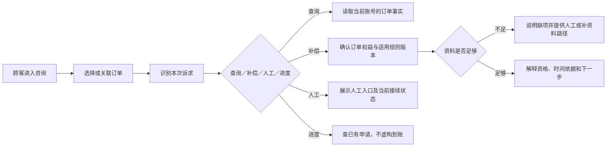

# 公开证据参考工作流：用途、图和测试边界

当前市场对比以[三平台＋本系统12格证据表](market-comparison.md)为主；下面是接收方依据可见页面和公开研究构造的参考流程，不是平台内部代码或已还原的线上Agent。

来源：选单、时间说明、人工／进度入口取自林的11/11观察；权益版本要求取自Jacky规则材料及本轮官方链接核查。图中的统一节点排列、身份边界和缺项分流是我们为可检验性作的设计推断；截图不能证明平台内部按此顺序执行。

WOWService提供的是更进一步的公开架构参考：主Agent按场景取信号、调用专门Agent，并结合Handoff模式。[原报告§3](https://arxiv.org/html/2510.13291v2#S3)并未给出一个可直接复制的“按钮关键词美团客服”。SOP-Maze可用来选择困难类型；VitaBench有自有模拟环境，当前不接入其全部工具。

如果以后实现A，输入输出合同如下：有订单上下文便核账号再读取，没有则选单／追问；纯查单不弹补偿卡；资格按明确的一份政策；不确定就说明缺项并交接；有原工单便查原状态。A可实现菜单＋规则＋工单，支持基本多轮。若不调用模型，模型成本记0但不能把人工接管成本记0。

实验须分成两种：按各平台各自规则重放，只验证公开材料的一致性，不给真实平台记分；或者A/B/C共用本组demo-v1，比较自建方案的行为，这时成绩不代表平台表现。不能混合两种口径。完整A/B/C新实验当前未启动，未把这张设计图记成实测成果。
